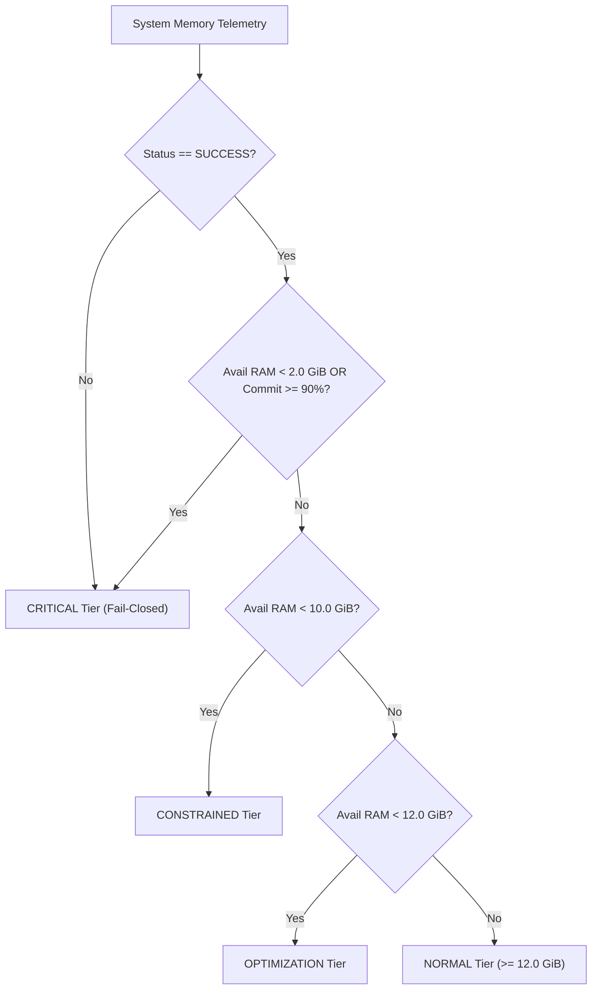

# NOVA Compute — Phase 2C-B: Adaptive Memory Reclaimer (AMR) Architecture Design

**Reference:** Phase 2C-B Final Stabilization & AMR  
**Author:** Antigravity (Implementation Engineer)  
**Governance:** User (Project Owner) & ChatGPT (Lead Architect / Technical Reviewer)  
**Status:** IMPLEMENTED & VERIFIED (Software Only — Model Inference Not Launched)

---

## 1. Executive Summary & Core Objective

The **NOVA Adaptive Memory Reclaimer (AMR)** is an intelligent, resource-aware memory management subsystem embedded within NOVA's Resource Steward architecture (`nova/resource_steward/adaptive_memory.py`).

Its primary design objective is to enable NOVA to monitor memory pressure tiers proactively, throttle reclamation operations, safely reclaim unused process runtime allocations, and provide verifiable before/after accounting—**without endangering Windows host stability, evicting user applications, or purging critical operating system standby caches**.

---

## 2. Open-Source Architectural Study & Comparative Analysis

To design AMR rigorously, we analyzed two prominent open-source Windows memory management utilities:
1. **Mem Reduct** (`https://github.com/henrypp/memreduct`) by Henry++
2. **WinMemClean** (`https://github.com/nusu-github/WinMemClean`) by nusu-github

### 2.1 Patterns Analyzed

Both utilities operate by issuing Windows native API calls to forcefully reduce working sets and flush system-wide memory lists:
- **`EmptyWorkingSet` (`K32EmptyWorkingSet`)**: Iterates through all accessible process IDs on the machine and requests the NT memory manager to trim the process working set down to zero.
- **`NtSetSystemInformation` with `SystemFileCacheInformation`**:
  - `MemoryPurgeStandbyList` (Command 4): Purges the OS standby list (cached files, executables, mmap pages).
  - `MemoryFlushModifiedList` (Command 3): Flushes dirty file-backed pages to storage.
  - `MemoryEmptyWorkingSets` (Command 2): Trims working sets across all user and system processes.
- **`SetSystemFileCacheSize`**: Shrinks the file system cache working set.

### 2.2 Comparative Decision Matrix: Adopt vs. Reject

| Technique / Feature | Mem Reduct / WinMemClean Approach | NOVA Compute AMR Implementation | Engineering Rationale |
| :--- | :--- | :--- | :--- |
| **Working Set Trimming (`EmptyWorkingSet`)** | Iterates over ALL system and user processes (`OpenProcess(PROCESS_SET_QUOTA)`) | **STRICTLY FORBIDDEN** (Static AST verified) | Causes massive hard-page-fault storms across active user applications (e.g., Edge, VS Code, IDE), freezing the desktop and harming user experience. |
| **System Standby List Purging (`NtSetSystemInformation(4)`)** | Clears standby pages to inflate "Available RAM" metric | **STRICTLY FORBIDDEN** (Static AST verified) | In SSD/mmap-backed MoE inference, model weights reside in the standby page cache! Purging standby destroys model cache locality and kills token decode speed. |
| **Modified Page List Flushing (`NtSetSystemInformation(3)`)** | Flushes dirty pages to disk | **STRICTLY FORBIDDEN** | Forces unnecessary NVMe disk write bursts, increasing disk latency. |
| **System Privileges (`SeProfileSingleProcessPrivilege` / `SeIncreaseQuotaPrivilege`)** | Requires Administrator / elevated token | **UNPRIVILEGED USER-SPACE ONLY** | NOVA must never require elevated privileges to run safely on workstation laptops. |
| **Multi-Tier Pressure Monitoring** | Monitored via percentage threshold triggers | **ADOPTED & ADAPTED** | Hierarchical operational pressure tiers based on physical GiB and commit ratio. |
| **Cooldown Throttling** | Timer-based periodic cleanups | **ADOPTED** | Enforces a strict 30-second cooldown to prevent CPU and allocator thrashing. |
| **Before / After Delta Verification** | Computes freed memory percentage | **ADOPTED & HARDENED** | Exact physical byte delta measurement (`ram_delta_gib = post_ram - pre_ram`) with strict $\ge 10\text{ MB}$ significance threshold. |

---

## 3. The `SAFE_AUTO` Execution Model

AMR operates exclusively under the **`SAFE_AUTO`** execution policy. The operational boundary of `SAFE_AUTO` is strictly limited to NOVA-owned resources:

1. **Python Generational Garbage Collection**:
   - Executes `gc.collect(2)` to reclaim cyclical references and orphaned telemetry/diagnostics objects across all Python runtime generations.
2. **Internal Buffer Release**:
   - Evicts internal temporary buffers, parsed ASTs, and diagnostic cache structures registered with `AdaptiveMemoryController.register_cleaner()`.
3. **Zero Host Side-Effects**:
   - Never calls `OpenProcess` with modifying rights against non-NOVA PIDs.
   - Never terminates or suspends external applications.
   - Never requests NT kernel cache purges.

---

## 4. Multi-Tier Memory Pressure Classification

The `MemoryPressureDetector` categorizes system memory into four deterministic operational tiers:

1. **NORMAL Tier ($\ge 12.0\text{ GiB}$)**:
   - System memory is abundant. Inference can execute with comfortable workspace reserves.
   - Action: `NO_ACTION_REQUIRED`. Reclamation bypassed.
2. **OPTIMIZATION Tier ($10.0\text{ GiB} \le \text{RAM} < 12.0\text{ GiB}$)**:
   - Hardware satisfies minimum inference requirements ($10.0\text{ GiB}$), but workspace headroom is constrained.
   - Action: Executes `SAFE_AUTO` reclamation pass to prune runtime overhead.
3. **CONSTRAINED Tier ($2.0\text{ GiB} \le \text{RAM} < 10.0\text{ GiB}$)**:
   - System memory is below the minimum threshold required for Configuration D ($10.0\text{ GiB}$).
   - Action: Executes `SAFE_AUTO` pass. If post-reclamation RAM remains below $10.0\text{ GiB}$, the preflight gate **fails closed**, completely gating inference launch.
4. **CRITICAL Tier ($< 2.0\text{ GiB}$ or Commit $\ge 90.0\%$)**:
   - Machine is under severe paging or commit exhaustion risk.
   - Action: Immediate preflight rejection or live supervisor abort.

---

## 5. Cooldown Management & Thrashing Prevention

The `ReclamationCooldownManager` enforces a configurable cooldown window (default: $30.0\text{ seconds}$):
- Uses monotonic clock tracking (`clock()`).
- Guarantees that repetitive diagnostic passes do not cause allocator churn.
- Reports `cooldown_applied = True` and `overall_status = NO_ACTION_REQUIRED` when invoked during an active cooldown.
- Allows explicit override only when `force=True` is provided (e.g., during critical preflight checks).

---

## 6. Verifiable Telemetry & Delta Accounting

Every AMR execution follows a strict transactional flow:
1. **Pre-reclamation snapshot**: `monitor.get_system_memory()` captures baseline physical RAM, commit bytes, and paging rates.
2. **Reclamation invocation**: `SafeMemoryReclaimer.reclaim()` executes safe actions and measures execution duration in seconds.
3. **Post-reclamation snapshot**: Fresh `monitor.get_system_memory()` call verifies physical memory response.
4. **Mathematical delta evaluation**:
   $$\Delta_{\text{RAM}} = \text{RAM}_{\text{post}} - \text{RAM}_{\text{pre}}$$
   - If $\Delta_{\text{RAM}} \ge 10\text{ MB}$ ($0.00976\text{ GiB}$): `RECLAMATION_COMPLETED`.
   - If $\Delta_{\text{RAM}} < 10\text{ MB}$: `NO_MEASURABLE_IMPROVEMENT` (accurately reflecting that external processes hold the bulk of memory).
5. **Audit Logging**: Persists `MemoryReclaimReport` to `reports/phase2c/memory_reclamation/reclaim_latest.json` and timestamped JSON files.
