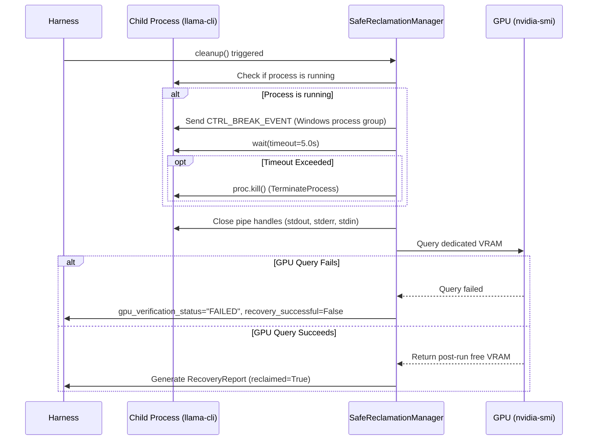

# NOVA Compute — Phase 2C Resource Recovery Policy

**Document ID:** `NOVA-POL-P2C-RECOVERY-01`  
**Date:** 2026-11-04  
**Author:** Antigravity (Implementation Engineer)  
**Governance:** Implementation submitted; **Awaiting Lead Architect (ChatGPT) & Project Owner Review**  
**Status:** ACTIVE POLICY (REVISED)  

---

## 1. Purpose & Core Principles

This policy establishes strict operating boundaries for process management, memory reclamation, and post-execution cleanup in NOVA Compute. Because the platform runs on a resource-constrained consumer laptop (16 GB physical RAM, 6 GB VRAM) alongside the user's active applications and operating system tasks, NOVA must act as a well-behaved guest.

The governing principles are:
1. **Zero Impact on User Applications:** Never kill, suspend, or alter the priority of applications belonging to the user or system.
2. **Explicit Child Ownership:** Cleanup actions apply strictly to processes spawned directly by NOVA.
3. **Accurate Windows Teardown:** Differentiate console control shutdown from forced termination. Do not claim that `TerminateProcess` or `proc.kill()` is graceful.
4. **Clean Exit Guarantees:** Ensure GPU contexts, file handles, pipe descriptors, and reader threads are systematically reclaimed upon completion or abort.
5. **Trustworthy Verification:** If post-run telemetry or residual process checks cannot be completed successfully, recovery must be marked as `UNKNOWN` or `FAILED`, never reported as success.

---

## 2. Permitted vs. Prohibited Actions

### 2.1 Strictly Prohibited Actions (Non-Negotiable)

- **Prohibited Process Termination:**
  - Running `taskkill /F /IM ...` or `Stop-Process` against browsers (`msedge`, `chrome`, `firefox`), development environments (`code`, `cursor`), communication tools, or system binaries.
  - Terminating any process whose PID is not the active child process spawned by `llama-cli`.
- **Prohibited Memory Manipulations:**
  - Invoking `EmptyWorkingSet` or global working set trim on external processes. Trimming working sets globally causes severe disk paging spikes across Windows when user apps re-fault their pages.
  - Disabling, modifying, or shrinking the Windows Pagefile (`pagefile.sys`).
  - Purging the Windows standby list or file system cache globally. Clean file-backed cache pages accelerate mmap model loading and must be managed solely by the Windows memory manager.
- **Prohibited Elevation & Driver Actions:**
  - Requiring or using Windows Administrator privileges (`runas` / elevated shells).
  - Resetting the GPU driver (`nvidia-smi -r` or driver restarts).

### 2.2 Permitted and Required Actions

- **Bounded Child Process Management:**
  - Spawning `llama-cli` with `CREATE_NEW_PROCESS_GROUP | BELOW_NORMAL_PRIORITY_CLASS` (`0x00004200`) on Windows to ensure UI fluidity and isolate console control signals.
  - Capturing and storing the child process PID.
  - Attempting console control shutdown via `CTRL_BREAK_EVENT` with a 5.0-second grace period.
  - Escalating to `proc.kill()` (`TerminateProcess`) if the child process fails to terminate within 5.0 seconds.
- **Resource Recovery Verification:**
  - Closing all standard I/O pipes (`stdin`, `stdout`, `stderr`) and joining reader threads.
  - Inspecting post-run GPU telemetry. If the GPU query fails, report `gpu_verification_status = "FAILED"`, `residual_vram_leak_mib = None`, and `recovery_successful = False`.
  - Checking residual processes via `tasklist`. If the check fails, report `process_verification_status = "UNKNOWN"` and `recovery_successful = False`.
- **User-Centric Memory Advising:**
  - Inspecting resident memory of user-mode processes in read-only mode via `tasklist` and `GetProcessMemoryInfo`.
  - Computing the RAM deficit against the $\ge 10.0\text{ GiB}$ gate.
  - Listing candidate applications and observed working sets in terminal output, advising the user to save work and close them manually.
  - Explicitly documenting that observed working set is an indicator and does not guarantee an equivalent release of physical RAM.

---

## 3. Post-Run Verification Protocol

Following any inference run (whether successful, failed, or aborted), the `SafeReclamationManager` executes the following sequence:

1. **Child State Verification:** Confirms `poll()` returns an integer returncode.
2. **Handle Cleanup:** Explicitly closes pipe handles to prevent handle leaks.
3. **GPU Memory Verification:** Queries `nvidia-smi` to confirm VRAM usage has returned to the pre-run baseline ($\pm 100\text{ MiB}$). If lingering VRAM is detected, a warning is emitted. If the query fails, verification is marked `FAILED`.
4. **Audit Trail:** Appends recovery status, returncode, shutdown method, and VRAM delta to the execution telemetry log.
