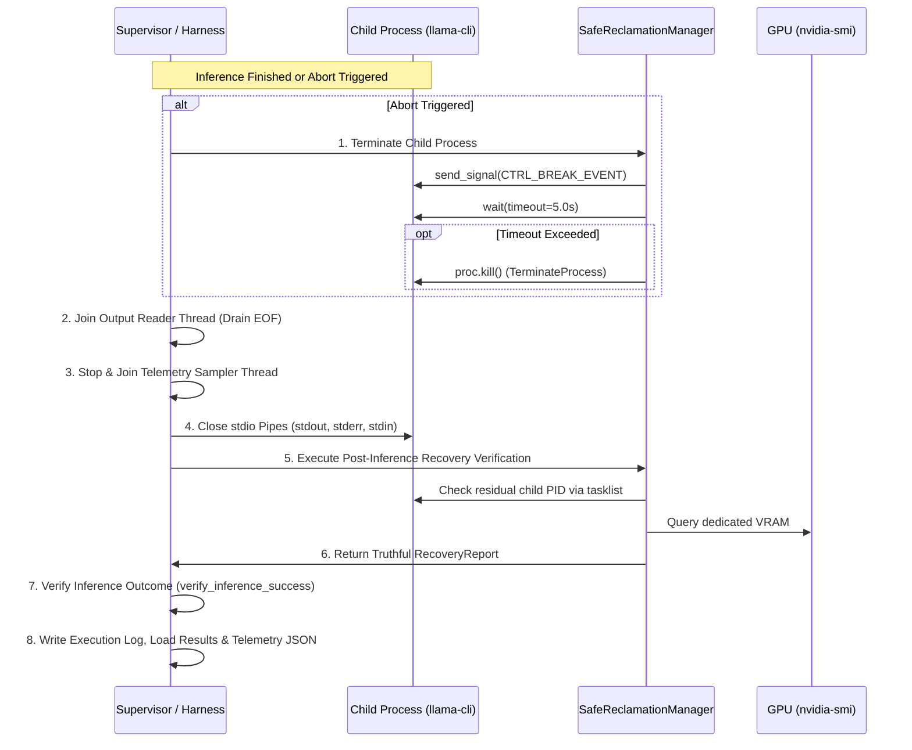

# NOVA Compute — Phase 2C Resource Recovery Policy

**Document ID:** `NOVA-POL-P2C-RECOVERY-01`  
**Date:** 2026-11-04  
**Author:** Antigravity (Implementation Engineer)  
**Governance:** Implementation submitted; **Awaiting Lead Architect (ChatGPT) & Project Owner Review**  
**Status:** ACTIVE POLICY (FINAL STABILIZATION)  

---

## 1. Purpose & Core Principles

This policy establishes strict operating boundaries for process management, memory reclamation, and post-execution cleanup in NOVA Compute. Because the platform runs on a resource-constrained consumer laptop (16 GB physical RAM, 6 GB VRAM) alongside the user's active applications and operating system tasks, NOVA must act as a well-behaved guest.

The governing principles are:
1. **Zero Impact on User Applications:** Never kill, suspend, or alter the priority of applications belonging to the user or system.
2. **Explicit Child Ownership:** Cleanup actions apply strictly to processes spawned directly by NOVA.
3. **Accurate Windows Teardown:** Differentiate console control shutdown from forced termination. Do not claim that `TerminateProcess` or `proc.kill()` is graceful.
4. **Clean Exit Guarantees:** Ensure GPU contexts, file handles, pipe descriptors, reader threads, and sampler threads are systematically reclaimed upon completion or abort.
5. **Truthful Verification:** If post-run telemetry, thread shutdown, or residual process checks cannot be completed successfully, recovery must be marked as `UNKNOWN` or `FAILED`, never reported as success.
6. **No Speculative Reclaim Promises:** Observed process working set (such as Microsoft Edge holding ~1.50–2.00 GiB) is an indicator of memory footprint, not a guarantee that closing the process will immediately release an identical amount of free physical RAM, due to Windows standby caching.

---

## 2. Permitted vs. Prohibited Actions

### 2.1 Strictly Prohibited Actions (Non-Negotiable)

- **Prohibited Process Termination:**
  - Running `taskkill /F /IM ...` or `Stop-Process` against browsers (`msedge`, `chrome`, `firefox`), development environments (`code`, `cursor`), communication tools, or system binaries.
  - Terminating any process whose PID is not the active child process spawned by `llama-cli`.
- **Prohibited Memory Manipulations:**
  - Invoking `EmptyWorkingSet` or global working set trim on external processes. Trimming working sets globally causes severe disk paging spikes across Windows when user apps re-fault their pages.
  - Disabling, modifying, or shrinking the Windows Pagefile (`pagefile.sys`).
  - Purging the Windows standby list or file system cache globally. Clean file-backed cache pages accelerate mmap model loading and must be managed solely by the Windows memory manager.
- **Prohibited Elevation & Driver Actions:**
  - Requiring or using Windows Administrator privileges (`runas` / elevated shells).
  - Resetting the GPU driver (`nvidia-smi -r` or driver restarts).

### 2.2 Permitted and Required Actions

- **Bounded Child Process Management:**
  - Spawning `llama-cli` with `CREATE_NEW_PROCESS_GROUP | BELOW_NORMAL_PRIORITY_CLASS` (`0x00004200`) on Windows to ensure UI fluidity and isolate console control signals.
  - Capturing and storing the child process PID.
  - Attempting console control shutdown via `proc.send_signal(signal.CTRL_BREAK_EVENT)` with a 5.0-second grace period.
  - Escalating to `proc.kill()` (`TerminateProcess`) if the child process fails to terminate within 5.0 seconds.
- **Resource Recovery Verification:**
  - Closing all standard I/O pipes (`stdin`, `stdout`, `stderr`) after child exit and joining output reader and sampler threads.
  - Inspecting post-run GPU telemetry. If the GPU query fails, report `gpu_verification_status = "FAILED"`, `residual_vram_leak_mib = None`, and `recovery_successful = False`.
  - Checking residual processes via exact PID matching in `tasklist`. If the check fails, report `process_verification_status = "UNKNOWN"` and `recovery_successful = False`.
  - Enforcing VRAM recovery tolerance ($\le 100\text{ MiB}$). If residual VRAM exceeds $100\text{ MiB}$, fail recovery.
- **User-Centric Memory Advising:**
  - Inspecting resident memory of user-mode processes in read-only mode via `tasklist` and `GetProcessMemoryInfo`.
  - Computing the RAM deficit against the $\ge 10.0\text{ GiB}$ gate.
  - Listing candidate applications, observed working sets, and measurement coverage (`instances_measured / instances_total`).
  - Explicitly documenting that observed working set is an indicator and does not guarantee an equivalent release of physical RAM.

---

## 3. Explicit 8-Stage Teardown Lifecycle

1. **Child Teardown Stage:** If an abort is triggered, child termination is initiated through `SafeReclamationManager` before any pipe closure or thread termination.
2. **Reader Thread Stage:** The reader thread continues draining until EOF and is joined with a timeout.
3. **Sampler Thread Stage:** The live telemetry sampler thread is stopped and joined.
4. **Handle Cleanup Stage:** All child stdio pipe handles are verified closed.
5. **Recovery Verification Stage:** Exact residual PIDs are verified using `tasklist`, and dedicated VRAM is queried via `nvidia-smi`.
6. **Report Generation Stage:** The `RecoveryReport` documents thread status, pipe status, shutdown method, and leak status.
7. **Outcome Verification Stage:** `verify_inference_success` evaluates exit code, generation markers, telemetry validity, and recovery status.
8. **Audit Trail Stage:** Logs and telemetry records are committed to `reports/phase2c/first_inference/`.
