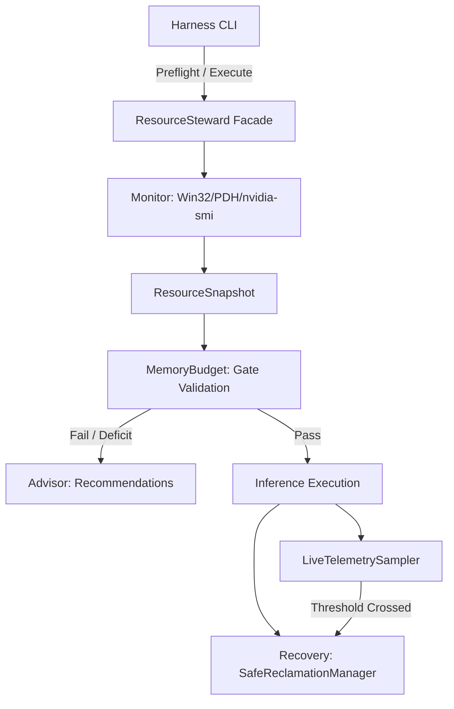

# NOVA Compute — Phase 2C Resource Steward Design

**Document ID:** `NOVA-REP-P2C-STEWARD-01`  
**Date:** 2026-11-04  
**Author:** Antigravity (Implementation Engineer)  
**Governance:** Reviewed by ChatGPT (Lead Architect) & User (Project Owner)  
**Status:** IMPLEMENTED & VERIFIED  

---

## 1. Executive Summary

The **NOVA Resource Steward** (`nova.resource_steward`) is an architectural safety subsystem built to govern execution on constrained consumer hardware (specifically the NVIDIA RTX 4050 Laptop GPU with 6 GB VRAM and 16 GB system RAM).

Its core mandate is:
1. **Machine & Workspace Preservation:** Prevent NOVA inference processes from destabilizing Windows or starving active user applications.
2. **Fail-Closed Diagnostics:** Refuse execution whenever telemetry sensors (Win32 API, NVIDIA Management Library / `nvidia-smi`, PDH subsystem) return unavailable, malformed, or ambiguous data. Never coerce missing data to zero.
3. **Strict Child Isolation:** Manage child processes exclusively via bounded process handles and PID checks; strictly prohibit indiscriminate system termination (`taskkill /F /IM ...`).
4. **Advisory Non-Destructive Memory Management:** Provide actionable advice to the user on how to reclaim physical RAM before execution without touching external processes.

---

## 2. Module Architecture

The `nova.resource_steward` package is decoupled from model architectures and inference runtimes (`llama-cli`), operating as an independent hardware supervisor.

```
nova/resource_steward/
├── __init__.py          # Unified ResourceSteward façade
├── models.py            # Typed dataclasses and fail-closed enums
├── policy.py            # Resource limits, gate thresholds, and abort boundaries
├── monitor.py           # Native Win32, PDH, and GPU telemetry samplers
├── memory_budget.py     # Evaluation gates and deficit calculators
├── advisor.py           # User-space non-destructive memory optimizer
└── recovery.py          # Graceful child lifecycle & VRAM leak recovery
```

### Component Interaction Flow



---

## 3. Subsystem Breakdown

### 3.1 Data Models & Status Enums (`models.py`)

All telemetry outputs are structured via immutable dataclasses with explicit validation statuses:

- **`TelemetryStatus`**: `SUCCESS`, `PARTIAL`, `FAILED`, `UNKNOWN`.
  - When status is not `SUCCESS`, gate checks treat the metric as unverified and trigger a fail-closed stop.
- **`ProcessTelemetry`**: Tracks `working_set_bytes` (resident memory), `peak_working_set_bytes`, `private_commit_bytes`, `pagefile_charge_bytes` (process commit charge), and CPU/GPU metrics.
- **`ResourceSnapshot`**: Captures physical RAM, system commit load, disk free space, PDH counters, and GPU telemetry with UTC timestamps.
- **`GateResult`**: Records gate boolean, reason string, measured values, deficit, and sensor status.
- **`MemoryAdvice`**: Structured suggestions identifying candidate processes for manual user closure.

### 3.2 System & GPU Telemetry Monitor (`monitor.py`)

1. **Win32 Memory Telemetry:**
   - Uses `ctypes.windll.kernel32.GlobalMemoryStatusEx` with `MEMORYSTATUSEX`.
   - Records `ullTotalPhys`, `ullAvailPhys`, `ullTotalPageFile` (Commit Limit), `ullAvailPageFile`, and `dwMemoryLoad`.
   - Any API failure flags `ram_status = TelemetryStatus.FAILED`.

2. **Windows PDH (Performance Data Helper) Subsystem:**
   - Hooks native counters via `ctypes.windll.pdh`:
     - `\Memory\Pages Input/sec` & `\Memory\Pages Output/sec` (Total memory page traffic)
     - `\Memory\Page Reads/sec` & `\Memory\Page Writes/sec` (Page disk read/write operations)
     - `\PhysicalDisk(_Total)\Disk Read Bytes/sec` & `Disk Write Bytes/sec`
   - Initialized and queried with differential interval sampling. Failures degrade gracefully to `PARTIAL` without corrupting memory gates.

3. **GPU & Compute Interrogation:**
   - Queries `nvidia-smi --query-gpu=... --format=csv,noheader,nounits` for VRAM capacity, free VRAM, temperature, power, and utilization.
   - Queries active compute processes via `nvidia-smi --query-compute-apps=...`.
   - **Fail-Closed Fix:** Unlike previous scripts that substituted `[]` on query failure, any non-zero exit code or timeout flags `gpu_process_status = TelemetryStatus.FAILED`. Preflight explicitly fails if GPU status cannot be confirmed.

4. **Process Tracking:**
   - Enumerates top memory consumers using `psutil.process_iter()`.
   - Maps `pmem.wset` to Resident Working Set and `pmem.private` to Private Commit.

### 3.3 Resource Policy & Gating (`policy.py` & `memory_budget.py`)

Configured safety thresholds:

| Metric | Minimum Required Gate | Critical Abort Limit | Description |
| :--- | :--- | :--- | :--- |
| **Available RAM** | $\ge 10.0\text{ GiB}$ | $< 2.0\text{ GiB}$ (sustained $> 5\text{s}$) | Ensures working-set headroom for CPU MoE experts |
| **Workspace Reserve** | $\ge 4.0\text{ GiB}$ | Alert triggered if crossed | Protects Windows OS and editor stability |
| **Free VRAM** | $\ge 5,500\text{ MiB}$ | $< 512\text{ MiB}$ | Ensures 4,286 MiB static VRAM allocation fits cleanly |
| **Competing GPU Apps** | $0$ active compute apps | $> 0$ active | Prevents VRAM preemption or context thrashing |
| **System Commit** | $< 90\%$ commit load | $\ge 90\%$ commit load | Prevents system commit exhaustion |
| **Disk Free Space** | $\ge 25.0\text{ GB}$ | $< 5.0\text{ GB}$ | Guarantees scratch space for mmap paging |

### 3.4 Non-Destructive Advisory Engine (`advisor.py`)

When available RAM fails the $\ge 10.0\text{ GiB}$ gate, the Advisor identifies non-essential background processes and formats friendly recommendations:
- Identifies web browsers (`msedge`, `chrome`, `firefox`), development apps (`code`, `cursor`), and local LLM runtimes (`ollama`, `lmstudio`).
- Aggregates multi-process memory consumption (e.g., Edge tab renderers).
- Calculates exact RAM deficit and presents the smallest set of applications the user can close to satisfy the preflight gate.
- **Rule Enforcement:** Does NOT invoke `TerminateProcess`, `os.kill`, or PowerShell process commands. All actions require manual user choice.

### 3.5 Safe Reclamation & Process Recovery (`recovery.py`)

- **`SafeReclamationManager`**:
  - Bound strictly to the child process PID spawned by NOVA.
  - On abort or test termination, issues graceful termination (`SIGINT` on POSIX, `terminate()` / `WM_CLOSE` on Windows).
  - Waits up to a configurable grace timeout (default 5.0 seconds).
  - If the child process refuses to exit, escalates to `kill()` (`TerminateProcess`).
  - Closes all file and process pipe handles to prevent handle leaks.
  - Queries `nvidia-smi` post-exit to verify that VRAM was fully reclaimed.

---

## 4. Execution Modes in `run_inference_with_telemetry.py`

The execution harness CLI has been refactored with explicit argument parsing:

1. **Default Mode (No arguments):**  
   Runs read-only preflight diagnostics, displays memory status, checks safety gates, and exits with code 0 (or code 1 on gate failure). **NEVER launches inference.**
2. **`--preflight`:**  
   Explicit alias for read-only preflight diagnostics.
3. **`--execute`:**  
   Runs a fresh live preflight. If and only if all gates pass, starts `llama-cli` in `BELOW_NORMAL_PRIORITY_CLASS` with live telemetry sampling.
4. **`--memory-report`:**  
   Dumps a comprehensive JSON memory report without checking gates or launching models.
5. **`--dry-run`:**  
   Performs preflight, verifies configuration flags, builds the exact CLI command line, and prints it without starting `llama-cli`.
