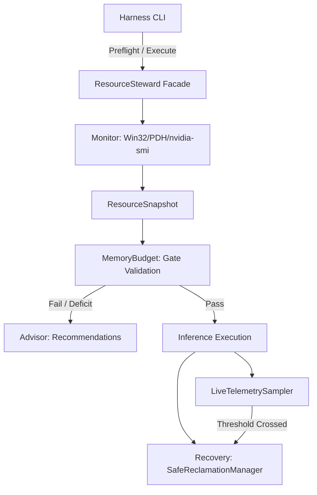

# NOVA Compute — Phase 2C Resource Steward Design

**Document ID:** `NOVA-REP-P2C-STEWARD-01`  
**Date:** 2026-11-04  
**Author:** Antigravity (Implementation Engineer)  
**Governance:** Implementation submitted; **Awaiting Lead Architect (ChatGPT) & Project Owner Review**  
**Status:** IMPLEMENTED & VERIFIED (FOLLOW-UP REMEDIATION)  

---

## 1. Executive Summary

The **NOVA Resource Steward** (`nova.resource_steward`) is an architectural safety subsystem built to govern execution on constrained consumer hardware (specifically the NVIDIA RTX 4050 Laptop GPU with 6 GB VRAM and 16 GB system RAM).

Its core mandate is:
1. **Machine & Workspace Preservation:** Prevent NOVA inference processes from destabilizing Windows or starving active user applications.
2. **Fail-Closed Diagnostics:** Refuse execution whenever telemetry sensors (Win32 API, NVIDIA Management Library / `nvidia-smi`, PDH subsystem) return unavailable, malformed, or ambiguous data. Never coerce missing or malformed data to zero.
3. **Strict Child Isolation & Accurate Windows Shutdown:** Manage child processes exclusively via owned process handles in a dedicated process group (`CREATE_NEW_PROCESS_GROUP`). Attempt graceful console break (`CTRL_BREAK_EVENT`) with a 5.0-second grace window, escalating to forced termination (`TerminateProcess` / `kill()`) only when uncooperative. Strictly prohibit indiscriminate system termination (`taskkill /F /IM ...`).
4. **Advisory Non-Destructive Memory Management:** Provide actionable advice to the user on how to reclaim physical RAM before execution without touching external processes. Observed working-set figures are explicitly documented as indicators, not guarantees of immediate physical RAM release.
5. **Asynchronous Output & Timestamped Aborts:** Supervise child execution using a dedicated background stdout reader and monotonic timestamp (`time.monotonic()`) tracking, preventing monitor thread stalls and duplicate sample counting.

---

## 2. Module Architecture

The `nova.resource_steward` package is decoupled from model architectures and inference runtimes (`llama-cli`), operating as an independent hardware supervisor.

```
nova/resource_steward/
├── __init__.py          # Unified ResourceSteward façade
├── models.py            # Typed dataclasses and fail-closed enums
├── policy.py            # Resource limits, gate thresholds, and abort boundaries
├── monitor.py           # Native Win32, PDH, and GPU telemetry samplers
├── memory_budget.py     # Evaluation gates and deficit calculators
├── advisor.py           # User-space non-destructive memory optimizer
└── recovery.py          # Graceful child lifecycle & VRAM leak recovery
```

### Component Interaction Flow



---

## 3. Subsystem Breakdown

### 3.1 Data Models & Status Enums (`models.py`)

All telemetry outputs are structured via immutable dataclasses with explicit validation statuses:

- **`TelemetryStatus`**: `SUCCESS`, `FAILED`, `UNKNOWN`.
  - When status is not `SUCCESS`, gate checks treat the metric as unverified and trigger a fail-closed stop.
- **`ProcessResourceSnapshot`**:
  - `working_set_bytes`: Observed resident physical memory (from `tasklist` or Win32 API).
  - `private_commit_bytes`: Private committed virtual memory (`PrivateUsage`), populated only when measured via `GetProcessMemoryInfo`; set to `None` if unmeasured.
  - `pids`: List of PIDs associated with the application instance group.
- **`RecoveryReport`**:
  - `shutdown_method`: Records actual shutdown mechanism (`NATURAL_EXIT`, `CTRL_BREAK`, `FORCED_TERMINATION`, `NO_CHILD`).
  - `gpu_verification_status` & `process_verification_status`: Reports `VERIFIED`, `FAILED`, or `UNKNOWN`.
  - `recovery_successful`: Strictly requires that the child terminated, no residual processes were found, process verification succeeded, GPU verification succeeded, and post-run RAM telemetry was valid.

### 3.2 System & GPU Telemetry Monitor (`monitor.py`)

1. **Win32 Memory Telemetry:**
   - Uses `ctypes.windll.kernel32.GlobalMemoryStatusEx` with `MEMORYSTATUSEX`.
   - Records `ullTotalPhys`, `ullAvailPhys`, `ullTotalPageFile` (Commit Limit), `ullAvailPageFile`, and `dwMemoryLoad`.
   - Any API failure flags `status = TelemetryStatus.FAILED`.

2. **Windows PDH (Performance Data Helper) Subsystem:**
   - Hooks native counters via `ctypes.windll.pdh`:
     - `\Memory\Pages Input/sec` & `\Memory\Pages Output/sec` (Total memory page traffic)
     - `\Memory\Page Reads/sec` & `\Memory\Page Writes/sec` (Page disk read/write operations)
     - `\PhysicalDisk(_Total)\Disk Read Bytes/sec` & `Disk Write Bytes/sec`
   - Initialized and queried with differential interval sampling. Failures degrade gracefully without corrupting memory gates.

3. **GPU & Compute Interrogation:**
   - Queries `nvidia-smi --query-gpu=... --format=csv,noheader,nounits` for VRAM capacity, free VRAM, temperature, power, and utilization.
   - Queries active compute processes via `nvidia-smi --query-compute-apps=...` using robust `csv.reader`.
   - **Fail-Closed CSV Parsing:** Any malformed or non-empty unparseable row flags `compute_processes = None` and `status = TelemetryStatus.FAILED`. A genuinely empty query represents 0 active compute applications.

4. **Process Tracking & Memory Accounting:**
   - Enumerates top memory consumers using `tasklist /FO CSV /NH`.
   - Aggregates PIDs and observed working sets by executable name.
   - Queries `GetProcessMemoryInfo` for accessible PIDs to collect actual private commit. Unmeasured fields are explicitly recorded as `None`, never copied from working set.

### 3.3 Resource Policy & Preflight Gating (`policy.py` & `memory_budget.py`)

Preflight gates evaluated prior to execution:

| Gate Name | Metric | Required Gate | Description |
| :--- | :--- | :--- | :--- |
| `telemetry_integrity` | Sensor Health | All sensors `SUCCESS` | Fail-closed: halts if RAM, GPU, or Disk probes fail |
| `avail_ram` | Available RAM | $\ge 10.0\text{ GiB}$ | Ensures working-set headroom for CPU MoE experts |
| `system_commit` | System Commit | $< 90.0\%$ | Prevents system commit exhaustion |
| `avail_vram` | Free VRAM | $\ge 5,500\text{ MiB}$ | Guarantees static VRAM allocation fits cleanly |
| `no_competing_gpu` | Compute Apps | $0$ active apps | Prevents GPU preemption or context thrashing |
| `disk_free` | Free Storage | $\ge 25.0\text{ GB}$ | Guarantees scratch space for mmap paging |

### 3.4 Non-Destructive Advisory Engine (`advisor.py`)

When available RAM fails the $\ge 10.0\text{ GiB}$ gate, the Advisor identifies candidate background processes and formats friendly recommendations:
- Identifies web browsers (`msedge`, `chrome`, `firefox`), development apps (`code`, `cursor`), and local LLM runtimes (`ollama`, `lmstudio`).
- Aggregates multi-process memory consumption (e.g., Edge tab renderers).
- Displays observed working set and private commit figures, explicitly noting that released physical RAM depends on OS standby caching.
- **Rule Enforcement:** Does NOT invoke `TerminateProcess`, `os.kill`, or PowerShell commands against external applications.

### 3.5 Safe Reclamation & Accurate Windows Teardown (`recovery.py`)

- **`SafeReclamationManager`**:
  - Bound strictly to the child process PID spawned by NOVA.
  - Spawns child in `CREATE_NEW_PROCESS_GROUP | BELOW_NORMAL_PRIORITY_CLASS`.
  - On teardown, sends `CTRL_BREAK_EVENT` via `os.kill` for console control shutdown.
  - Waits up to `grace_period_sec` (5.0s). If still alive, escalates to `proc.kill()` (`TerminateProcess`).
  - Explicitly closes process stdio pipes (`stdout`, `stderr`, `stdin`).
  - Verifies residual processes via `tasklist`. If verification fails, marks status as `UNKNOWN` and rejects recovery success.
  - Queries `nvidia-smi` post-exit to verify VRAM return. If GPU query fails, sets `gpu_verification_status = "FAILED"` and `residual_vram_leak_mib = None`.

---

## 4. Execution Modes in `run_inference_with_telemetry.py`

The execution harness CLI enforces mutually exclusive argument parsing:

1. **Default Mode (No arguments):**  
   Runs read-only preflight diagnostics, displays memory status, checks all 6 safety gates, and exits with code 0 (pass) or code 1 (unmet gates). **NEVER launches inference.**
2. **`--preflight`:**  
   Explicit alias for read-only preflight diagnostics.
3. **`--execute`:**  
   Runs a fresh live preflight immediately prior to launch. If and only if all gates pass, starts `llama-cli` in `BELOW_NORMAL_PRIORITY_CLASS` and `CREATE_NEW_PROCESS_GROUP` with asynchronous output draining and live telemetry sampling.
4. **`--memory-report`:**  
   Dumps a comprehensive JSON memory report without launching models.
5. **`--dry-run`:**  
   Performs preflight, verifies configuration flags, builds the exact CLI command line, and prints it without starting `llama-cli`.
