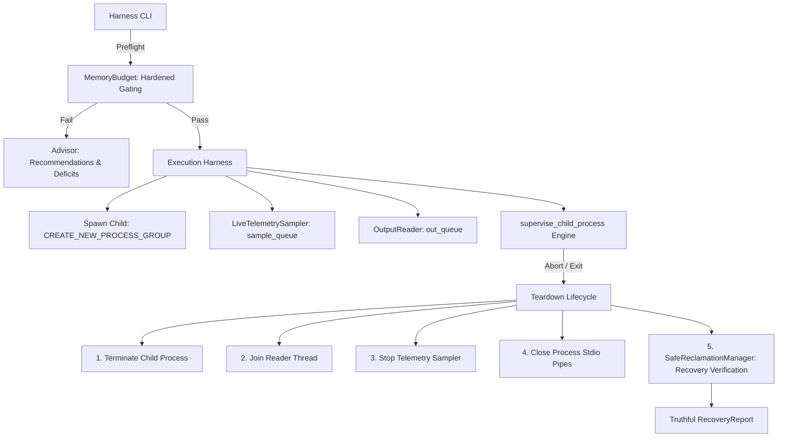

# NOVA Compute — Phase 2C Resource Steward Design

**Document ID:** `NOVA-REP-P2C-STEWARD-01`  
**Date:** 2026-11-04  
**Author:** Antigravity (Implementation Engineer)  
**Governance:** Implementation submitted; **Awaiting Lead Architect (ChatGPT) & Project Owner Review**  
**Status:** IMPLEMENTED & STABILIZED (FINAL STABILIZATION)  

---

## 1. Executive Summary

The **NOVA Resource Steward** (`nova.resource_steward`) is an architectural safety subsystem built to govern execution on constrained consumer hardware (specifically the NVIDIA RTX 4050 Laptop GPU with 6 GB VRAM and 16 GB system RAM).

Its core mandate is:
1. **Machine & Workspace Preservation:** Prevent NOVA inference processes from destabilizing Windows or starving active user applications.
2. **Fail-Closed Diagnostics:** Refuse execution whenever telemetry sensors (Win32 API, `nvidia-smi`, PDH subsystem) return unavailable, malformed, contradictory, or ambiguous data. Never coerce missing data to zero.
3. **Decoupled Production Supervision:** The `supervise_child_process` engine consumes ordered telemetry from a thread-safe queue, monitors monotonic low-RAM durations, detects sample gaps/duplicates, and drains child stdout asynchronously without stalling.
4. **Strict Child Isolation & Accurate Windows Teardown:** Spawn child processes in a dedicated process group (`CREATE_NEW_PROCESS_GROUP | BELOW_NORMAL_PRIORITY_CLASS`). Attempt graceful console break (`proc.send_signal(signal.CTRL_BREAK_EVENT)`), waiting up to a 5.0-second grace window, and escalating to forced termination (`proc.kill()` / `TerminateProcess`) only when uncooperative. Forced termination is never mislabeled as graceful.
5. **Truthful Resource Accounting & Advisory:** Distinguish resident working sets from private commit charges. Track instance measurement coverage explicitly (`measured / total instances`), and avoid promising guaranteed physical RAM release from application closure.

---

## 2. Module Architecture

The `nova.resource_steward` package is decoupled from model architectures and inference runtimes (`llama-cli`), operating as an independent hardware supervisor.

```
nova/resource_steward/
├── __init__.py          # Unified ResourceSteward façade
├── models.py            # Typed dataclasses and fail-closed enums
├── policy.py            # Resource limits, gate thresholds, and abort boundaries
├── monitor.py           # Native Win32, PDH, and GPU telemetry samplers
├── memory_budget.py     # Evaluation gates, deficit calculators, and commit validation
├── advisor.py           # User-space non-destructive memory optimizer
├── recovery.py          # Graceful child lifecycle, thread joining & VRAM leak recovery
└── supervisor.py        # Decoupled, testable child process supervision engine
```

### Component Interaction Flow



---

## 3. Subsystem Breakdown

### 3.1 Ordered Telemetry Sample Queue (`monitor.py` & `supervisor.py`)

To prevent race conditions, sample drops, or stale-state preservation:
- `LiveTelemetrySampler` places every telemetry measurement into a thread-safe `sample_queue`.
- Each sample carries:
  - `sample_id`: Sequential integer incrementing strictly by 1 (`1, 2, 3...`).
  - `timestamp_monotonic`: Precise monotonic timestamp (`time.monotonic()`) captured at sensor polling.
- `supervise_child_process` validates that samples arrive strictly in order:
  - If `sample_id < expected_sample_id`: fails closed on duplicate or out-of-order sample.
  - If `sample_id > expected_sample_id`: fails closed on detected sample gap.
- **Monotonic Timer Reset:** If a fresh sample reports available RAM $\ge 2.0\text{ GiB}$, the critical low-RAM timer is reset immediately (`critical_ram_start_monotonic = None`), preventing transient drops from accumulating into false aborts.

### 3.2 Hardened System Commit Preflight Gate (`memory_budget.py`)

Preflight evaluates system commit with rigorous validation:
- Commit limit must be positive ($> 0$).
- Available commit and committed bytes must be non-negative.
- Committed bytes must not exceed the commit limit.
- Commit percentage must be a finite number between $0.0\%$ and $100.0\%$.
- Any NaN, infinity, contradictory counter, or failed query fails closed (`INVALID / UNAVAILABLE`).
- Fails preflight if commit load is $\ge 90.0\%$.

### 3.3 Accurate Process Memory Accounting (`monitor.py` & `advisor.py`)

- `tasklist` provides observed resident working set (`pmem.wset`).
- `GetProcessMemoryInfo` queries actual private commit (`PrivateUsage`) across all accessible PIDs in each group.
- Tracks `instances_measured` vs `instances_total`. If some PIDs are inaccessible (e.g. access denied on system services), the metric is explicitly flagged as partial (`is_partial_private_commit = True`).
- Working set is strictly separated from private commit.
- Advisor recommendations explicitly state that observed working set is an indicator, not a guarantee of physical RAM recovery, due to Windows standby caching.

### 3.4 Accurate Windows Process Teardown & Truthful Recovery (`recovery.py`)

- Spawns child in `CREATE_NEW_PROCESS_GROUP | BELOW_NORMAL_PRIORITY_CLASS`.
- Teardown sequence:
  1. Sends `proc.send_signal(signal.CTRL_BREAK_EVENT)`.
  2. Waits for configured grace period (5.0s).
  3. If child exits cleanly, records `shutdown_method = "CTRL_BREAK"`.
  4. If child remains alive or signal fails, escalates to `proc.kill()` and records `shutdown_method = "FORCED_TERMINATION"`.
- Recovery verification:
  - Residual processes verified by exact PID matching in `tasklist /FO CSV /NH`.
  - Stdio pipes verified closed on child handle.
  - Output reader thread and telemetry sampler thread verified stopped.
  - Post-run GPU VRAM leak calculated against pre-run baseline. If GPU query fails, `residual_vram_leak_mib = None` and `gpu_verification_status = "FAILED"`.
  - If VRAM leak exceeds $100.0\text{ MiB}$, `recovery_successful = False`.
  - Child termination success (`child_terminated_successfully`) is separated from full recovery success (`recovery_successful`).

---

## 4. Execution Harness Modes (`run_inference_with_telemetry.py`)

The CLI enforces mutually exclusive argument parsing:

1. **Default Mode (No arguments):** Runs read-only preflight diagnostics, displays memory status, checks all 6 safety gates, and exits with code 0 (pass) or code 1 (unmet gates). **NEVER launches inference.**
2. **`--preflight`:** Explicit alias for read-only preflight diagnostics.
3. **`--execute`:** Runs fresh preflight immediately prior to launch. If all gates pass, starts inference under Configuration D constraints.
4. **`--memory-report`:** Generates detailed process working set inventory with measurement coverage.
5. **`--dry-run`:** Validates command syntax and file existence without starting `llama-cli`.
