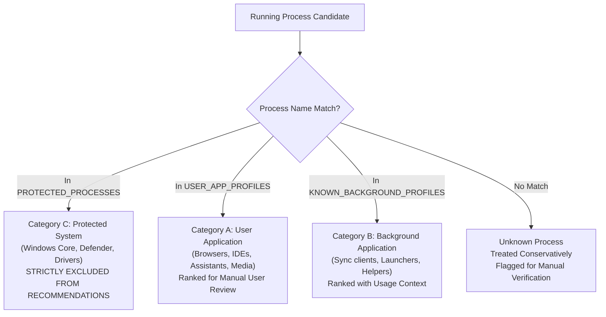

# NOVA Compute — Phase 2D: Intelligent Memory Advisor Architecture & Design

**Project:** NOVA Compute  
**Subsystem:** Intelligent Memory Advisor (`nova/resource_steward/advisor.py`)  
**Roles:** User = Project Owner; ChatGPT = Lead Architect; Antigravity = Implementation Engineer  
**Status:** IMPLEMENTED & VERIFIED (67 Automated Tests Passing; Model Inference Gated)

---

## 1. Executive Summary & Objective

The **Intelligent Memory Advisor** is a read-only diagnostic component integrated into NOVA Compute's Resource Steward architecture. Inspired by the transparent process monitoring capabilities of Mem Reduct, the Advisor assists workstation users in identifying unnecessary application memory consumption before launching resource-intensive MoE LLM inference workloads (e.g., Qwen3-30B-A3B under Configuration D).

### Core Operational Principles
1. **Strictly Read-Only:** The Advisor observes and reports; it never terminates, suspends, signals, or modifies external host processes.
2. **Complete User Control:** All application closure decisions remain under manual user control through normal Windows application interfaces.
3. **No Standby Cache Sabotage or Cleaner APIs:** Prohibits `EmptyWorkingSet`, `NtSetSystemInformation`, `SetSystemFileCacheSize`, and `SetProcessWorkingSetSize`.
4. **Transparent Telemetry Accounting:** Distinguishes resident physical memory (working set) from committed virtual memory (private commit), clearly flagging partial or restricted measurements.
5. **Fail-Closed Admission Fidelity:** Never bypasses or lowers the 10.0 GiB available physical RAM admission gate.

---

## 2. Safe Process Classification Taxonomy

The Memory Advisor partitions running processes into three deterministic operational tiers:



### Category A: User Applications (`ProcessCategory.USER_APPLICATION`)
Interactive desktop applications that users launch for tasks:
- **Web Browsers:** `msedge.exe`, `chrome.exe`, `firefox.exe`, `brave.exe`, `opera.exe`
- **Development IDEs & Editors:** `code.exe`, `devenv.exe`, `pycharm64.exe`, `idea64.exe`, `cursor.exe`, `antigravity.exe`
- **AI Assistants & Local LLMs:** `claude.exe`, `chatgpt.exe`, `ollama.exe`, `llama-server.exe`
- **Communication & Media:** `slack.exe`, `discord.exe`, `telegram.exe`, `teams.exe`, `zoom.exe`, `spotify.exe`
- **Launchers:** `steam.exe`, `epicgameslauncher.exe`

*Guidance:* "Save open files/tabs and close the application through its standard window interface."

### Category B: Background Applications (`ProcessCategory.BACKGROUND_APPLICATION`)
Optional background services, synchronization utilities, and development worker processes:
- **Cloud Storage Sync:** `onedrive.exe`, `dropbox.exe`, `googledrivesync.exe`
- **Development Workers:** `node.exe` (local dev servers), `language_server.exe` (IDE indexers)
- **Launcher Helpers:** `steamwebhelper.exe`, `epicwebhelper.exe`

*Guidance:* "Review whether this tool is actively required during inference; pause syncing or exit via system tray/terminal."

### Category C: Protected Processes (`ProcessCategory.PROTECTED_SYSTEM`)
Critical Windows infrastructure, security components, and hardware drivers:
- **Windows Core & Session:** `system`, `registry`, `smss.exe`, `csrss.exe`, `wininit.exe`, `services.exe`, `lsass.exe`, `winlogon.exe`, `svchost.exe`, `dwm.exe`, `explorer.exe`, `sihost.exe`, `taskhostw.exe`, `spoolsv.exe`, `ctfmon.exe`, `conhost.exe`, `runtimebroker.exe`
- **Security & Microsoft Defender:** `msmpeng.exe`, `nissrv.exe`, `securityhealthservice.exe`, `smartscreen.exe`, `securityhealthsystray.exe`, `sgrmbroker.exe`
- **Drivers & NVIDIA Services:** `nvcontainer.exe`, `nvdisplay.container.exe`, `nvsphelper64.exe`, `wlanext.exe`, `audiodg.exe`

*Governance Rule:* **Protected processes are strictly excluded from closure recommendations.** They are never manipulated, signaled, or terminated.

### Unknown Processes (`ProcessCategory.UNKNOWN`)
Unclassified processes exceeding memory thresholds are treated conservatively:
- Labeled as `[Unclassified Process]`.
- Advised for manual review; the user is explicitly warned not to terminate processes of unknown origin.

---

## 3. Working Set vs. Private Commit Telemetry Interpretation

The Advisor avoids misleading claims regarding reclaimable memory:

| Telemetry Metric | Technical Definition | Interpretation & Advisor Policy |
| :--- | :--- | :--- |
| **Working Set (`working_set_bytes`)** | Physical RAM pages currently resident in memory. | **Physical Memory Residency.** When an application closes, Windows releases its resident pages, but the OS memory manager may place pages into the standby list (file cache) rather than immediately increasing "Free" RAM. Actual physical RAM recovery must be confirmed via fresh system telemetry. |
| **Private Commit (`private_commit_bytes`)** | Virtual memory committed exclusively to this process against the system commit limit. | **Dedicated Process Virtual Commit Charge.** Closing an application directly releases this private commit charge against the system commit limit, reducing system commit pressure. **It is NOT guaranteed physical RAM recovery**, because pages may be paged out or shared with pagefile allocation. |
| **Measurement Coverage (`instances_measured / instances_total`)** | Accessible PIDs queried via `GetProcessMemoryInfo`. | **Explicitly Flagged Partial Coverage.** When user processes run with elevated instances (or child processes access-restricted), the Advisor marks the measurement as `partial` and displays queried coverage (e.g., `7/47 measured`). |

---

## 4. Transparent Memory Ranking & Telemetry Validation Methodology

### Telemetry Validation Before Aggregation
To prevent corrupted or failed process counters from skewing recommendations:
1. **Working Set Validation:** Each process snapshot must have `status == TelemetryStatus.SUCCESS`, `working_set_bytes` as a non-boolean integer (`isinstance(val, int) and not isinstance(val, bool)`), and `working_set_bytes >= 0`. Failed, negative, or boolean counters are strictly excluded from aggregates.
2. **Private Commit Validation:** When present, `private_commit_bytes` must be a non-boolean, non-negative integer. Missing or failed values never contribute to verified totals.
3. **Instance Accounting & Partial Coverage:** Total expected instances (`instances_total`) and measured instances (`instances_measured`) are tracked truthfully. Zero measured instances out of a positive total is never treated as complete; it is explicitly marked as unavailable/partial.

### Mathematical Distinction: Why Summing WS and Private Commit is Invalid
A process's working set represents physical RAM pages currently mapped into its page table. Private commit represents virtual address space pages committed exclusively by the process (backed either by RAM or the paging file). Because resident private pages reside **simultaneously in both the working set and private commit**, summing them directly ($WS + PC$) counts resident private memory twice and creates a mathematically false metric.

### Candidate Ordering: Working Set as Primary Consideration
Because NOVA Compute is constrained primarily by physical RAM residency for MoE weight paging, candidates holding $\ge 100\text{ MB}$ memory are ordered with physical working set as the primary factor:

1. **Primary Consideration ($WS_{\text{MB}}$):** Processes holding the largest resident physical working set are placed first to surface the greatest potential relief for physical RAM admission.
2. **Secondary Consideration (Category Priority):** When physical footprints are equal or comparable, interactive User Applications (Category A) are prioritized over Background Applications (Category B) because closing interactive user software is safer than stopping system background daemons.
3. **Tertiary Consideration (Private Commit):** Dedicated private virtual commit charge serves as the final tie-breaker, favoring processes whose closure also relieves system commit pressure.

$$\text{SortKey} = (\text{WS}_{\text{MB}}, \text{Priority}_{\text{category}}, \text{PrivateCommit}_{\text{MB}})$$

### Advisory Ranking Heuristic Score
The Advisor computes an advisory prioritization index:

$$\text{RankingScore} = \text{WS}_{\text{MB}} + \text{Bonus}_{\text{category}} + 0.05 \times (\text{PrivateCommit}_{\text{MB}} \text{ if available else } 0.0)$$

where $\text{Bonus}_{\text{category}} = 2.0$ for User Applications and $0.0$ otherwise.

**Advisory Disclaimer:** The ranking score is strictly a unitless prioritization index. It does **not** represent recoverable physical RAM.

---

## 5. Re-Measurement & Fresh Telemetry Admission Enforcement

```
[Inference Launch Attempt / CLI Request]
                │
                ▼
  [1. Intelligent Memory Advisor]
        │   ├─► Read-only telemetry collection (RAM, commit, top processes)
        │   ├─► Strict Counter Validation (SUCCESS, non-boolean int, non-negative)
        │   ├─► Canonical 3-Tier Categorization (Protected System Always Excluded)
        │   └─► Candidate Ranking (Physical Working Set as Primary Consideration)
        ▼
  [2. User Manual Action]
        │   └─► User closes selected application(s) via normal Windows UI
        ▼
  [3. Fresh Re-Measurement (`remeasure_memory`)]
        │   ├─► Strict Fresh Telemetry Enforcement (No caller snapshot injection permitted)
        │   ├─► Fresh hardware queries (RAM via GlobalMemoryStatusEx, GPU via NVML, Disk via GetDiskFreeSpaceEx)
        │   ├─► Truthful delta calculation (RAM gain, commit reduction)
        │   └─► Full Gate Suite Evaluation via MemoryBudgetManager.evaluate_gates()
        ▼
  [4. Preflight Gate Suite Evaluation]
        ├─► Gate 1: Telemetry Integrity (All fresh sensors SUCCESS, no NaN/inf, byte sum consistency)
        ├─► Gate 2: Available Physical RAM >= 10.0 GiB
        ├─► Gate 3: System Commit Charge < 90.0%
        ├─► Gate 4: Available VRAM >= 5,500 MiB
        ├─► Gate 5: Competing GPU Compute Apps == 0
        ├─► Gate 6: Free Disk Space >= 25.0 GB
        │
        ├─► ALL GATES PASSED:
        │     └─► ADMISSION GRANTED (Inference permitted subject to user authorization)
        └─► ANY GATE FAILS (e.g. RAM passes but GPU or disk sensor fails):
              └─► ADMISSION GATED (Fail-closed; reaching RAM threshold alone cannot grant admission)
```

**Rule:** `remeasure_memory()` cannot independently grant inference permission based on RAM alone. The public API strictly prohibits injecting caller-supplied GPU or disk snapshots. It always queries fresh telemetry across all hardware tiers directly through the monitor. Reaching $\ge 10.0\text{ GiB}$ RAM does not produce a passed preflight if VRAM, GPU contention, system commit, or disk space gates fail.

---

## 6. Static AST Safety Audit Compliance

Automated AST verification (`test_58_advisor_static_inspection_forbidden_apis_absent`) mathematically proves that none of the following identifiers exist in `advisor.py`:
- `EmptyWorkingSet`
- `K32EmptyWorkingSet`
- `NtSetSystemInformation`
- `MemoryPurgeStandbyList`
- `MemoryFlushModifiedList`
- `SetSystemFileCacheSize`
- `SetProcessWorkingSetSize`
- `TerminateProcess`
- `taskkill`
