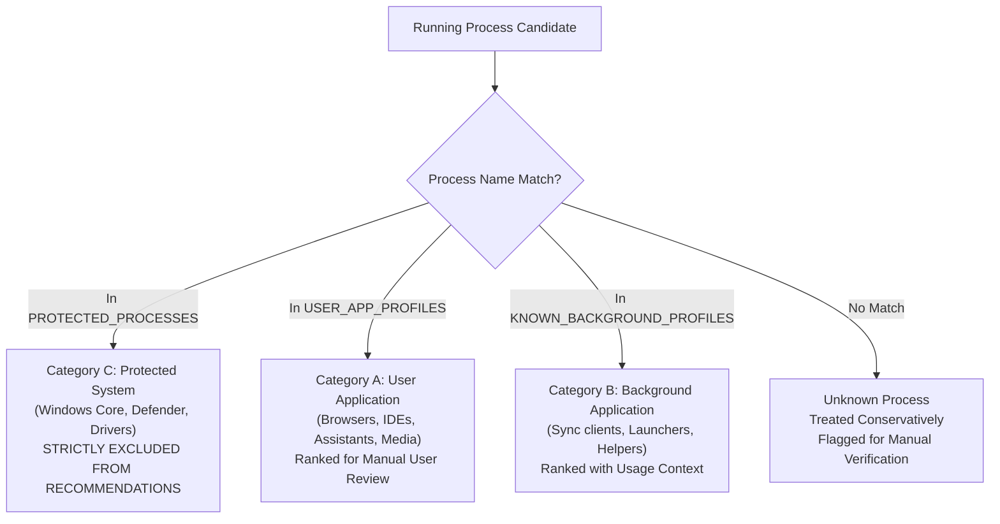

# NOVA Compute — Phase 2D: Intelligent Memory Advisor Architecture & Design

**Project:** NOVA Compute  
**Subsystem:** Intelligent Memory Advisor (`nova/resource_steward/advisor.py`)  
**Roles:** User = Project Owner; ChatGPT = Lead Architect; Antigravity = Implementation Engineer  
**Status:** IMPLEMENTED & VERIFIED (60 Automated Tests Passing; Model Inference Gated)

---

## 1. Executive Summary & Objective

The **Intelligent Memory Advisor** is a read-only diagnostic component integrated into NOVA Compute's Resource Steward architecture. Inspired by the transparent process monitoring capabilities of Mem Reduct, the Advisor assists workstation users in identifying unnecessary application memory consumption before launching resource-intensive MoE LLM inference workloads (e.g., Qwen3-30B-A3B under Configuration D).

### Core Operational Principles
1. **Strictly Read-Only:** The Advisor observes and reports; it never terminates, suspends, signals, or modifies external host processes.
2. **Complete User Control:** All application closure decisions remain under manual user control through normal Windows application interfaces.
3. **No Standby Cache Sabotage or Cleaner APIs:** Prohibits `EmptyWorkingSet`, `NtSetSystemInformation`, `SetSystemFileCacheSize`, and `SetProcessWorkingSetSize`.
4. **Transparent Telemetry Accounting:** Distinguishes resident physical memory (working set) from committed virtual memory (private commit), clearly flagging partial or restricted measurements.
5. **Fail-Closed Admission Fidelity:** Never bypasses or lowers the 10.0 GiB available physical RAM admission gate.

---

## 2. Safe Process Classification Taxonomy

The Memory Advisor partitions running processes into three deterministic operational tiers:



### Category A: User Applications (`ProcessCategory.USER_APPLICATION`)
Interactive desktop applications that users launch for tasks:
- **Web Browsers:** `msedge.exe`, `chrome.exe`, `firefox.exe`, `brave.exe`, `opera.exe`
- **Development IDEs & Editors:** `code.exe`, `devenv.exe`, `pycharm64.exe`, `idea64.exe`, `cursor.exe`, `antigravity.exe`
- **AI Assistants & Local LLMs:** `claude.exe`, `chatgpt.exe`, `ollama.exe`, `llama-server.exe`
- **Communication & Media:** `slack.exe`, `discord.exe`, `telegram.exe`, `teams.exe`, `zoom.exe`, `spotify.exe`
- **Launchers:** `steam.exe`, `epicgameslauncher.exe`

*Guidance:* "Save open files/tabs and close the application through its standard window interface."

### Category B: Background Applications (`ProcessCategory.BACKGROUND_APPLICATION`)
Optional background services, synchronization utilities, and development worker processes:
- **Cloud Storage Sync:** `onedrive.exe`, `dropbox.exe`, `googledrivesync.exe`
- **Development Workers:** `node.exe` (local dev servers), `language_server.exe` (IDE indexers)
- **Launcher Helpers:** `steamwebhelper.exe`, `epicwebhelper.exe`

*Guidance:* "Review whether this tool is actively required during inference; pause syncing or exit via system tray/terminal."

### Category C: Protected Processes (`ProcessCategory.PROTECTED_SYSTEM`)
Critical Windows infrastructure, security components, and hardware drivers:
- **Windows Core & Session:** `system`, `registry`, `smss.exe`, `csrss.exe`, `wininit.exe`, `services.exe`, `lsass.exe`, `winlogon.exe`, `svchost.exe`, `dwm.exe`, `explorer.exe`, `sihost.exe`, `taskhostw.exe`, `spoolsv.exe`, `ctfmon.exe`, `conhost.exe`, `runtimebroker.exe`
- **Security & Microsoft Defender:** `msmpeng.exe`, `nissrv.exe`, `securityhealthservice.exe`, `smartscreen.exe`, `securityhealthsystray.exe`, `sgrmbroker.exe`
- **Drivers & NVIDIA Services:** `nvcontainer.exe`, `nvdisplay.container.exe`, `nvsphelper64.exe`, `wlanext.exe`, `audiodg.exe`

*Governance Rule:* **Protected processes are strictly excluded from closure recommendations.** They are never manipulated, signaled, or terminated.

### Unknown Processes (`ProcessCategory.UNKNOWN`)
Unclassified processes exceeding memory thresholds are treated conservatively:
- Labeled as `[Unclassified Process]`.
- Advised for manual review; the user is explicitly warned not to terminate processes of unknown origin.

---

## 3. Working Set vs. Private Commit Telemetry Interpretation

The Advisor avoids misleading claims regarding reclaimable memory:

| Telemetry Metric | Technical Definition | Interpretation & Advisor Policy |
| :--- | :--- | :--- |
| **Working Set (`working_set_bytes`)** | Physical RAM pages currently resident in memory. | **Not guaranteed reclaimable RAM.** When an application closes, Windows frees its working set, but the OS memory manager may place pages into the standby list (file cache) rather than immediately increasing "Free" RAM. |
| **Private Commit (`private_commit_bytes`)** | Virtual memory committed exclusively to this process. | **Guaranteed commit charge reduction.** Closing an application directly releases this private commit charge against the system commit limit, reducing system commit pressure. |
| **Measurement Coverage (`instances_measured / instances_total`)** | Accessible PIDs queried via `GetProcessMemoryInfo`. | **Explicitly flagged.** When user processes run with elevated instances (or child processes access-restricted), the Advisor marks the measurement as `partial` and displays queried coverage (e.g., `7/47 measured`). |

---

## 4. Candidate Ranking Algorithm

Candidates are ranked using verified telemetry:
1. Aggregate working set and private commit are calculated across all PIDs sharing the executable name.
2. Filtering: Protected processes are discarded; applications holding $< 100\text{ MB}$ memory are filtered out.
3. Candidate score calculation:
   $$\text{Score} = (\text{Priority}_{\text{category}} \times 10^9) + (\text{PrivateCommit}_{\text{bytes}} + \text{WorkingSet}_{\text{bytes}})$$
   where User Applications ($\text{Priority}=2$) are prioritized over Background/Unknown applications ($\text{Priority}=1$) to ensure the most impactful, user-safe applications appear first.

---

## 5. Re-Measurement & Admission Control Workflow

```
[Inference Launch Attempt / CLI Request]
                │
                ▼
  [1. Intelligent Memory Advisor]
        │   ├─► Read-only telemetry collection (RAM, commit, top processes)
        │   ├─► Categorization (User, Background, Protected)
        │   └─► Generate ranked recommendations
        ▼
  [2. User Manual Action]
        │   └─► User closes selected application(s) via normal Windows UI
        ▼
  [3. Fresh Re-Measurement (`remeasure_memory`)]
        │   ├─► Fresh hardware query (GlobalMemoryStatusEx)
        │   ├─► Truthful delta calculation (RAM gain, commit reduction)
        │   └─► Compare against 10.0 GiB Available RAM admission gate
        ▼
  [4. Preflight Gate Evaluation]
        ├─► Avail RAM >= 10.0 GiB AND all other gates pass:
        │     └─► ADMISSION GRANTED (Inference permitted subject to user authorization)
        └─► Avail RAM < 10.0 GiB:
              └─► ADMISSION GATED (Fail-closed; inference halted)
```

**Rule:** The Advisor never overrides or softens the 10.0 GiB available RAM admission gate.

---

## 6. Static AST Safety Audit Compliance

Automated AST verification (`test_58_advisor_static_inspection_forbidden_apis_absent`) mathematically proves that none of the following identifiers exist in `advisor.py`:
- `EmptyWorkingSet`
- `K32EmptyWorkingSet`
- `NtSetSystemInformation`
- `MemoryPurgeStandbyList`
- `MemoryFlushModifiedList`
- `SetSystemFileCacheSize`
- `SetProcessWorkingSetSize`
- `TerminateProcess`
- `taskkill`
