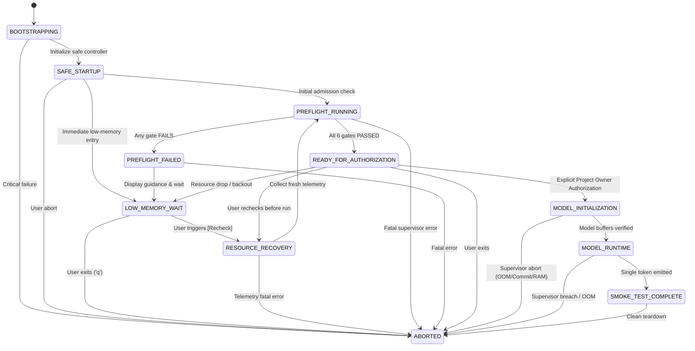

# NOVA Compute — Guided Startup State Machine
**Phase:** 3B.1 — Guided Low-Memory Startup & Progressive Model Loading  
**Status:** IMPLEMENTED AND FORMALLY VERIFIED  
**Module:** `nova.resource_steward.state_machine`  

---

## 1. Overview and Architecture

The NOVA Compute Guided Startup State Machine defines the formal lifecycle states for application bootstrap, resource admission qualification, low-memory user recovery guidance, and model execution gating.

### Core Governance Invariants:
1. **Decoupled Qualification**: Passing all six hardware admission gates transitions the system to `READY_FOR_AUTHORIZATION`. It **never** automatically transitions to `MODEL_INITIALIZATION` or executes inference.
2. **Explicit Authorization Gate**: Transitioning from `READY_FOR_AUTHORIZATION` to `MODEL_INITIALIZATION` strictly requires explicit Project Owner authorization (`authorized=True`). Unauthorized attempts raise `UnauthorizedInferenceError`.
3. **Fail-Closed Progression**: Any unmet admission gate blocks progression and routes to `PREFLIGHT_FAILED`, which transitions to `LOW_MEMORY_WAIT`.
4. **Deterministic Auditing**: Every state transition is recorded in an immutable history ledger (`StateTransitionRecord`) with UTC timestamps, source/destination states, and rationale.

---

## 2. Formal Lifecycle States

| State | Description | Model Loaded? | Inference Blocked? |
|---|---|---|---|
| `BOOTSTRAPPING` | Initial controller creation and telemetry subsystem loading. | NO | YES |
| `SAFE_STARTUP` | Lightweight startup mode active; minimal memory footprint; inference gated. | NO | YES |
| `LOW_MEMORY_WAIT` | Quiescent state awaiting user memory recovery or manual recheck request. | NO | YES |
| `RESOURCE_RECOVERY` | Transient state entered when user triggers `[Recheck Memory]`. | NO | YES |
| `PREFLIGHT_RUNNING` | Active sensor measurement and 6-gate fail-closed evaluation. | NO | YES |
| `PREFLIGHT_FAILED` | Intermediate state indicating one or more admission gates failed. | NO | YES |
| `READY_FOR_AUTHORIZATION` | System qualified. All 6 gates passed. Awaiting explicit user authorization. | NO | YES |
| `MODEL_INITIALIZATION` | Authorized initialization (Stages A–D): GGUF mmap and GPU weight buffers. | YES | YES |
| `MODEL_RUNTIME` | Authorized single-token smoke test execution under active supervisor. | YES | NO |
| `SMOKE_TEST_COMPLETE` | Smoke test finished; telemetry gathered; child process verified dead. | YES | YES |
| `ABORTED` | Terminal state entered on safety abort, supervisor breach, or user exit. | NO / Cleaned | YES |

---

## 3. Allowed Transitions Graph

---

## 4. Transition Rules & Enforced Boundaries

### 4.1 Transition Matrix

| From State | Allowed Destination States | Required Conditions / Gating Rules |
|---|---|---|
| `BOOTSTRAPPING` | `SAFE_STARTUP`, `ABORTED` | None |
| `SAFE_STARTUP` | `PREFLIGHT_RUNNING`, `LOW_MEMORY_WAIT`, `ABORTED` | None |
| `LOW_MEMORY_WAIT` | `RESOURCE_RECOVERY`, `ABORTED` | Triggered by user `Enter` / `R` or `Q` |
| `RESOURCE_RECOVERY` | `PREFLIGHT_RUNNING`, `ABORTED` | Fresh telemetry sampling initiated |
| `PREFLIGHT_RUNNING` | `READY_FOR_AUTHORIZATION`, `PREFLIGHT_FAILED`, `ABORTED` | `READY_FOR_AUTHORIZATION` requires **all 6 gates passed** |
| `PREFLIGHT_FAILED` | `LOW_MEMORY_WAIT`, `ABORTED` | Automatically returns to wait loop |
| `READY_FOR_AUTHORIZATION` | `MODEL_INITIALIZATION`, `RESOURCE_RECOVERY`, `LOW_MEMORY_WAIT`, `ABORTED` | `MODEL_INITIALIZATION` requires **`authorized=True`** |
| `MODEL_INITIALIZATION` | `MODEL_RUNTIME`, `ABORTED` | Requires model buffers successfully allocated |
| `MODEL_RUNTIME` | `SMOKE_TEST_COMPLETE`, `ABORTED` | Single token generated and process exited 0 |
| `SMOKE_TEST_COMPLETE` | `ABORTED` | Teardown complete |
| `ABORTED` | *None (Terminal)* | Terminal state |

### 4.2 Rejection of Illegal Transitions & Single-Use Authorization
The state machine implements strict runtime validation in `StartupStateMachine.transition_to()` and `StartupStateMachine.grant_authorization()`:
- **Direct Leap to Model Loading**: Attempting `BOOTSTRAPPING -> MODEL_INITIALIZATION` or `LOW_MEMORY_WAIT -> MODEL_INITIALIZATION` raises `InvalidStateTransitionError`.
- **Bypassing Authorization**: Attempting `READY_FOR_AUTHORIZATION -> MODEL_INITIALIZATION` without passing `authorized=True` or a granted authorization token raises `UnauthorizedInferenceError`.
- **Single-Use Token Consumption**: Once `grant_authorization(token)` is invoked and the transition to `MODEL_INITIALIZATION` occurs, the pending token is cleared immediately. Any subsequent model launch attempt requires fresh authorization.
- **Bypassing Gates**: Attempting `PREFLIGHT_RUNNING -> READY_FOR_AUTHORIZATION` when one or more gates failed raises `InvalidStateTransitionError`.

---

## 5. Verification Test Suite Coverage

The state machine and guided controller are verified by 16 dedicated unit tests in `tests/test_guided_startup.py`:

| Test Name | Validated Behavior | Result |
|---|---|---|
| `test_01_guided_startup_under_low_ram_does_not_start_llama_cli` | Starts under 8.23 GiB RAM without spawning llama-cli | **PASS** |
| `test_02_model_remains_not_loaded_in_low_memory_mode` | `model_loaded` is `False`, `inference_blocked` is `True` | **PASS** |
| `test_03_exact_ram_deficit_calculation_and_language_precision` | RAM deficit = 1.77 GiB; RAM language used; no disk mention | **PASS** |
| `test_04_manual_recovery_and_recheck_transitions` | State transitions through `RESOURCE_RECOVERY -> PREFLIGHT_RUNNING` | **PASS** |
| `test_05_ram_increases_but_remains_below_threshold` | RAM increases to 9.5 GiB; deficit updates to 0.5 GiB; still blocks | **PASS** |
| `test_06a_ram_sufficient_but_vram_fails_continues_blocking` | RAM = 10.4 GiB, VRAM = 5000 MiB; VRAM failure reported | **PASS** |
| `test_06b_ram_sufficient_but_commit_fails_continues_blocking` | RAM = 10.4 GiB, Commit = 91.7%; Commit failure reported | **PASS** |
| `test_06c_ram_sufficient_but_disk_fails_distinguishes_disk_from_ram` | RAM = 10.4 GiB, Disk = 15 GiB; Storage warning distinct from RAM | **PASS** |
| `test_07_all_gates_pass_enters_ready_for_authorization` | All 6 gates pass; enters `READY_FOR_AUTHORIZATION` | **PASS** |
| `test_08_successful_preflight_does_not_spawn_llama_cli` | In `READY_FOR_AUTHORIZATION`, llama-cli is not spawned | **PASS** |
| `test_09_user_exits_guided_mode_safe_shutdown` | User presses 'q'; safe shutdown to `ABORTED`; returns 0 | **PASS** |
| `test_10_unauthorized_inference_transition_rejected` | Unauthorized `MODEL_INITIALIZATION` raises `UnauthorizedInferenceError` | **PASS** |
| `test_11_cli_guided_start_mutual_exclusivity` | CLI flags `--guided-start` and `--execute` mutually exclusive | **PASS** |
| `test_12_controller_memory_profile_checkpoints_and_deltas` | Checkpoints A–D sampled, startup and idle deltas calculated | **PASS** |
| `test_13_controller_memory_profile_unknown_handling` | Failed telemetry marked UNKNOWN in tables without inventing numbers | **PASS** |
| `test_14_single_use_authorization_boundary_and_no_binary_launch` | Single-use token consumed; simulated auth never launches binary | **PASS** |
| `test_15_ready_display_configuration_d_and_safety_summary` | READY state displays full Configuration D command & safety parameters | **PASS** |
| `test_16_process_working_set_and_private_commit_reported_separately` | Process recommendations separately label working set & private commit | **PASS** |

---

## 6. Remaining Technical Unknowns and Phase 3B Smoke Test Readiness

1. **WDDM Page Migration Latency During Initial Offload**: While Configuration D allocates ~4.8 GiB of VRAM on a 6.0 GiB GPU, Windows WDDM driver memory management may induce brief page migration latency during tensor allocation. This will be measured directly via high-frequency telemetry in Phase 3B.
2. **NVMe Read Burst on Cold First Token**: First-token latency will be dominated by cold-cache NVMe reads as initial model tensors are faulted into memory. Cold vs. warm cache timings will be reported separately.
3. **Standby Cache Residency Post-Exit**: Windows may retain clean model pages in the Standby File Cache after the child process exits. This does not represent a memory leak, as the memory manager can reclaim standby pages instantaneously.
