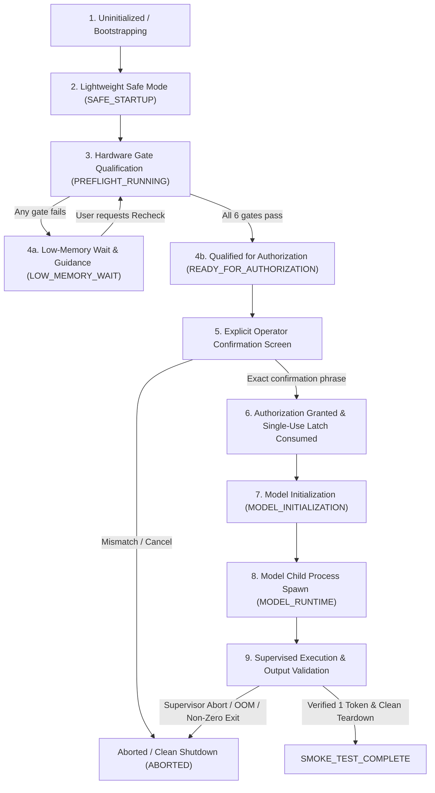

# NOVA Compute — Phase 3B.4
# Authorized Execution Architecture & Supervised Inference Launcher Integration

**Document:** `reports/phase3/PHASE3B4_AUTHORIZED_EXECUTION_ARCHITECTURE.md`  
**Phase:** 3B.4 — Authorization State Machine and Supervised Inference Launcher Integration  
**Status:** IMPLEMENTED AND FORMALLY VERIFIED (MOCKED TESTING ONLY)  
**Repository:** `Imagen2dragon/NOVA-compute`  
**Branch:** `feature/phase2d-memory-advisor`  
**Project Owner:** User  
**Lead Architect:** ChatGPT  
**Implementation Engineer:** Antigravity  

---

## 1. Executive Summary

Phase 3B.4 connects the existing `GuidedStartupController`, `StartupStateMachine`, the explicit confirmation mechanism, and the production supervised inference launcher (`scripts/run_inference_with_telemetry.py`) into **one secure, auditable, fail-closed execution pipeline**.

Prior to Phase 3B.4, the guided startup state machine operated in simulation mode, and the CLI execution entrypoint (`--execute`) bypassed the interactive state machine. Phase 3B.4 eliminates this duality:
1. Every inference execution pathway is routed through `StartupStateMachine` and `GuidedStartupController`.
2. Direct invocation of `execute_inference()` without an authorized controller and legitimate qualification history is strictly blocked by `UnauthorizedInferenceError`.
3. The `--execute` CLI flag is protected and delegates directly to `GuidedStartupController.run_interactive()`.
4. A session-scoped `ExecutionLatch` guarantees that **at most one** model subprocess creation can ever occur per controller session, enforcing a strict non-retrying execution policy.
5. Live inference execution remains **unauthorized** during this phase; all integration and boundary tests are executed with mocked subprocesses and telemetry.

---

## 2. Unified Execution Pathway Architecture

The complete authorized execution pathway progresses through nine formal stages, with no shortcuts or bypass routes permitted:



### Detailed Stage Specifications:

1. **Bootstrapping (`BOOTSTRAPPING`)**: Controller process initializes with minimal memory footprint (~26 MB working set). Model files are not opened.
2. **Safe Startup (`SAFE_STARTUP`)**: The controller enters safe mode; inference state is `BLOCKED`.
3. **Preflight Running (`PREFLIGHT_RUNNING`)**: All six mandatory admission gates are evaluated atomically:
   - `telemetry_integrity`: All sensors reporting SUCCESS; GiB-byte agreement within $10^{-9}\text{ GiB}$.
   - `avail_ram`: Free physical RAM $\ge 10.0\text{ GiB}$ ($10,737,418,240\text{ bytes}$).
   - `system_commit`: Total virtual commit charge $< 90.0\%$ of system commit limit.
   - `avail_vram`: Free dedicated VRAM $\ge 5,500.0\text{ MiB}$ (AD107).
   - `no_competing_gpu`: Competing GPU compute applications $== 0$.
   - `disk_free`: Free model drive storage $\ge 25.0\text{ GiB}$ ($26,843,545,600\text{ bytes}$).
4. **Qualification Boundary (`READY_FOR_AUTHORIZATION`)**:
   - Reached **only** if all 6 gates pass and genuine preflight report evidence is recorded.
   - Model weights remain completely unmapped (`model_loaded == False`).
   - Inference remains strictly blocked (`inference_blocked == True`).
5. **Pre-Execution Confirmation**:
   - Displays the target binary, GGUF model path, exact Configuration D arguments, 1-token boundary, and supervisor thresholds.
   - Requires the operator to type the exact phrase:
     ```
     RUN CONFIGURATION D SMOKE TEST ONCE
     ```
   - Case-insensitive comparison; any mismatch, empty string, or whitespace aborts immediately without launching inference.
6. **Single-Use Authorization Token & Execution Latch**:
   - `grant_authorization(token)` validates that preflight evidence is fresh ($\le 300.0\text{s}$).
   - Transition to `MODEL_INITIALIZATION` immediately clears `_pending_authorization_token` (single-use guarantee).
   - `ExecutionLatch.consume()` trips the session latch, preventing any second subprocess creation.
7. **Model Initialization (`MODEL_INITIALIZATION`)**:
   - Runtime binary and model file existence verified.
   - Pre-flight admission re-verified immediately prior to spawn.
8. **Model Runtime (`MODEL_RUNTIME`)**:
   - Subprocess spawned with `CREATE_NEW_PROCESS_GROUP` and `BELOW_NORMAL_PRIORITY_CLASS`.
   - Asynchronous reader thread starts consuming `stdout`/`stderr`.
   - `LiveTelemetrySampler` begins 500ms time-series collection.
9. **Supervised Execution & Completion**:
   - `supervise_child_process()` monitors telemetry and stdout lines.
   - If supervisor triggers abort (e.g. VRAM $< 512\text{ MiB}$, RAM $< 2\text{ GiB}$, commit $\ge 90\%$, or CUDA OOM), child process is gracefully signaled via `CTRL_BREAK_EVENT`, forcefully killed if unresponsive, and state transitions to `ABORTED`.
   - If execution completes cleanly with return code 0, single-token output verified (`eval time = ... / 1 runs`), and resources fully recovered, state transitions to `SMOKE_TEST_COMPLETE`.

---

## 3. Session Execution Latch Specification

The `ExecutionLatch` class enforces that **at most one** model subprocess execution can occur per controller session:

```python
class ExecutionLatch:
    """Enforces that at most one model subprocess execution can occur per session."""
    def __init__(self):
        self._consumed: bool = False

    @property
    def is_consumed(self) -> bool:
        return self._consumed

    def consume(self) -> None:
        if self._consumed:
            raise UnauthorizedInferenceError(
                "Execution latch already consumed: exactly one model subprocess creation is permitted per session."
            )
        self._consumed = True
```

### Invariants:
- `ExecutionLatch` is instantiated on `GuidedStartupController` initialization.
- Tripped immediately upon entering `launch_authorized_inference()`.
- Once tripped, all subsequent calls to `launch_authorized_inference()` raise `UnauthorizedInferenceError`.
- No automatic retries, loops, or re-executions are permitted in the same session.

---

## 4. Legitimate Qualification History Enforcement

To prevent malicious or accidental bypass via direct state assignment (e.g. `sm._current_state = StartupState.READY_FOR_AUTHORIZATION`), the controller implements `has_legitimate_qualification_history()`:

```python
def has_legitimate_qualification_history(self) -> bool:
    if not self.last_preflight_report or not getattr(self.last_preflight_report, "passed", False):
        return False

    history_states = [rec.to_state for rec in self.state_machine.history]
    if StartupState.PREFLIGHT_RUNNING not in history_states:
        return False
    if StartupState.READY_FOR_AUTHORIZATION not in history_states:
        return False

    gates = getattr(self.last_preflight_report, "gates", {})
    required_gates = {
        "telemetry_integrity", "avail_ram", "system_commit",
        "avail_vram", "no_competing_gpu", "disk_free"
    }
    if not required_gates.issubset(set(gates.keys())):
        return False
    for g_name in required_gates:
        if not getattr(gates[g_name], "passed", False):
            return False

    ram = getattr(self.last_preflight_report, "system_ram", None)
    if ram and (not math.isfinite(getattr(ram, "avail_phys_gib", 0.0)) or ram.avail_phys_gib < 0):
        return False

    return True
```

If `launch_authorized_inference()` or `execute_inference()` is invoked without legitimate history, the call fails closed, transitions to `ABORTED`, and raises `UnauthorizedInferenceError`.

---

## 5. Stale Evidence Protection Window

Hardware availability is dynamic. A qualification performed several minutes prior to execution may no longer reflect physical reality.

The state machine enforces an empirical **300.0-second (5-minute)** preflight evidence freshness window:
- When entering `READY_FOR_AUTHORIZATION` via passing preflight, the monotonic timestamp is recorded (`_preflight_timestamp_monotonic = clock()`).
- In `grant_authorization()`, the current monotonic time is compared against the preflight timestamp.
- If `now - _preflight_timestamp_monotonic > 300.0s`, authorization is rejected:
  ```
  UnauthorizedInferenceError: Preflight evidence is stale (305.0s > 300.0s). Fresh hardware qualification required before authorization.
  ```

---

## 6. Subprocess Ownership & Targeting Boundaries

The supervised launcher maintains strict boundaries regarding operating system process containment:

1. **NOVA-Owned Process Targeting**:
   - `supervise_child_process(proc=proc, ...)` receives the exact `subprocess.Popen` handle created by NOVA.
   - All recovery operations (`terminate_child_process`, `close_process_pipes`) strictly operate on `proc.pid` and `proc.stdout`.
   - External user applications, browser processes, and system services are **never** targeted or signaled.
2. **Process Group Semantics**:
   - The child process is spawned with Win32 flags `CREATE_NEW_PROCESS_GROUP | BELOW_NORMAL_PRIORITY_CLASS`.
   - `CREATE_NEW_PROCESS_GROUP` isolates console break signals, enabling `CTRL_BREAK_EVENT` delivery to the child without interrupting the runner.
   - **No Windows Job Object is implemented**: No tree-wide descendant process containment is claimed.

---

## 7. Truthful Single-Token Output Verification

`verify_inference_success()` enforces strict parsing of the `--perf` context output:
- **Verified Success**: Output must contain `eval time = ... / 1 runs` (or `tokens generated: 1`), exit code must be `0`, telemetry must have valid samples, reader must reach confirmed EOF, and post-inference resource recovery must be verified.
- **Ambiguous Output Rejection**: If `eval time` is present without `/ 1 runs`, or if only `prompt eval time` is present (0 generated tokens evaluated), the run is classified as `InferenceOutcome.UNVERIFIED`.
- An unverified outcome is never represented as a successful smoke test and transitions the controller to `ABORTED`.
