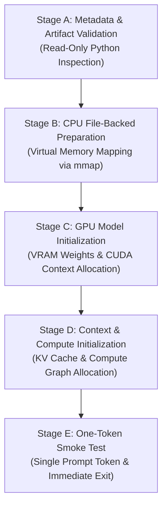

# NOVA Compute — Progressive Model Loading Design
**Phase:** 3B.1 — Guided Low-Memory Startup & Progressive Model Loading  
**Status:** DESIGN & ARCHITECTURAL SPECIFICATION  
**Target Architecture:** NVIDIA RTX 4050 Laptop GPU (6,141 MiB GDDR6), 16 GB System RAM, Windows 11 Home (WDDM 3.2)  
**Target Model:** Qwen3-30B-A3B (Q4_K_M GGUF, 18.25 GiB file size, 48 Transformer Layers, 128 MoE Experts per Layer)  

---

## 1. Executive Summary and Principles

Running an 18.25 GiB MoE model on a hardware platform with 6 GB VRAM and 16 GB system RAM requires strict adherence to memory hierarchy mechanics. Rather than treating model execution as an opaque black box, NOVA partitions the model initialization and runtime verification lifecycle into **five observable, progressive stages (Stages A through E)**.

### Core Architectural Principles
1. **No Fictional Mid-Kernel Pauseability**: llama.cpp's runtime binary executes model initialization as a single sequential pipeline once invoked. NOVA does not invent unsupported C++ hooks or pretend that individual layer allocations inside `llama_init_from_model` can be paused interactively from Python. Progressivity is achieved through structured pre-flight stages, isolated subprocess boundaries, external telemetry sampling, and strict supervisor containment.
2. **File-Backed mmap Isolation**: The 18.25 GiB model file is mapped via read-only memory-mapped file I/O (`-lm mmap`). This creates virtual address mappings without forcing all 18.25 GiB into physical RAM at startup. Windows manages clean file-backed pages on demand via page faults.
3. **Immutability of Configuration D**: Configuration parameters are frozen. Under no circumstances will NOVA automatically adjust offload layers, context length, or batch sizes if admission or loading encounters pressure.
4. **Zero Inference Authorization Boundary**: Model initialization and execution remain completely blocked until all six admission gates pass AND the Project Owner issues explicit authorization.

---

## 2. Progressive Stages (Stages A through E)



---

### Stage A — Metadata and Artifact Validation (Pre-Invocation)

**Execution Context:** In-process Python controller prior to spawning any runtime subprocess.  
**Hardware Impact:** Zero VRAM allocated, zero GPU compute, minimal RAM (< 10 MiB Python overhead).

#### Required Validations:
1. **Model Artifact Path & Integrity**:
   - Path: `models/qwen3-30b/Qwen_Qwen3-30B-A3B-Q4_K_M.gguf`.
   - File existence verified via `os.path.isfile()`.
   - File size verified: exactly 19,598,740,736 bytes (~18.25 GiB).
2. **Runtime Binary Verification**:
   - Path: `runtime/windows/llama-cpp/llama-cli.exe`.
   - Executable presence and execute permissions verified.
3. **GGUF Metadata Verification**:
   - Architecture header confirmed: `qwen3`.
   - Quantization format confirmed: `Q4_K_M`.
   - Expert architecture: 128 experts per layer, top-8 activated per token.
4. **Negative Guarantees**:
   - Model weight tensors are NOT mapped into host virtual address space during Stage A.
   - GPU device context is NOT initialized.
   - GPU model buffers are NOT allocated.

---

### Stage B — CPU File-Backed Preparation (Subprocess Launch)

**Execution Context:** Subprocess launched with `BELOW_NORMAL_PRIORITY_CLASS` (0x00004000) and `CREATE_NEW_PROCESS_GROUP` (0x00000200).  
**Hardware Impact:** Host virtual address space reservation (~18.5 GiB); physical RAM pages faulted in demand-driven fashion.

#### Runtime Parameters:
- `-lm mmap`: Memory mapping enabled.
- `mlock`: Disabled (never lock pages in physical RAM).
- `-ncmoe 40`: First 40 layers of MoE weights pinned to CPU/host memory hierarchy.

#### Telemetry & Operating System Semantics:
- **Virtual Memory vs. Resident Footprint**: `mmap` calls Windows `CreateFileMappingW` and `MapViewOfFileEx`. This reserves virtual address space in the child process without writing to the Windows pagefile (backing store is the clean `.gguf` file on NVMe disk).
- **Physical Memory Pressure**: As `llama-cli` parses tensor headers, only accessed pages enter physical RAM.
- **Cache Integrity**: NOVA strictly forbids clearing the Windows standby file cache or forcing working set trimmings. Windows Standby Cache legitimately buffers clean model pages and can be evicted instantaneously by the memory manager if physical RAM is needed.

---

### Stage C — GPU Model Initialization (Weight Buffers)

**Execution Context:** `llama-cli.exe` CUDA backend initialization.  
**Hardware Impact:** VRAM dedicated footprint jumps from baseline (~240 MiB) to active model weight allocation (~4,700–5,100 MiB).

#### Runtime Parameters:
- `-ngl 48`: Up to 48 layers targeted for GPU offload.
- `-ncmoe 40`: CPU placement of MoE weights in layers 0–39. Only non-MoE weights (attention, norms, router gates) of layers 0–39 and all weights of layers 40–47 are stored in VRAM.
- `--moe-cache-mib 0`: GPU expert cache strictly **DISABLED**.

#### Telemetry Instrumentation Points:
1. **$T_0$ (Pre-Init Baseline VRAM)**: Captured immediately prior to subprocess launch (target: $\le 250\text{ MiB}$ used, $\ge 5,800\text{ MiB}$ free).
2. **$T_1$ (CUDA Driver / Context Init)**: WDDM driver overhead and cuBLAS context allocation (~150–250 MiB).
3. **$T_2$ (Weight Buffer Allocation)**: Dedicated VRAM committed for offloaded tensors.
4. **VRAM Safety Margin**: Minimum 512 MiB free VRAM must remain at all times during weight loading. If free VRAM drops below 512 MiB, the supervisor immediately aborts the process.

---

### Stage D — Context and Compute Initialization (KV Cache & Scratch)

**Execution Context:** llama.cpp allocation of attention buffers and computational execution graph.  
**Hardware Impact:** Additional ~24 MiB dedicated VRAM for KV cache; dynamic scratch memory for forward pass.

#### Runtime Parameters:
- `-c 512`: Context length frozen at 512 tokens.
- `-b 64`: Batch size 64.
- `-ub 16`: Physical micro-batch size 16.
- `-ctk q8_0 -ctv q8_0`: Q8_0 KV cache quantization.
- `-fa auto`: Flash Attention auto-dispatch.

#### Memory Budget Verification:
- **Theoretical KV Cache Allocation**:
  $$\text{KV Size} = 2 \times n_{\text{layers}} \times n_{\text{heads\_kv}} \times d_{\text{head}} \times c_{\text{ctx}} \times \text{bytes\_per\_elem}$$
  For Q8_0 at context 512, this evaluates to **24.0 MiB**, well within safe limits.
- **Compute Scratch Graph**: Scratch memory is dynamically allocated. Telemetry sampler tracks peak VRAM to ensure scratch allocations do not breach the 512 MiB minimum free VRAM floor.

---

### Stage E — One-Token Smoke Test (Execution & Completion)

**Execution Context:** Prompt evaluation and single-token decode.  
**Hardware Impact:** Short burst of GPU compute and memory bandwidth; immediate process exit.

#### Runtime Parameters:
- `-p "Hello"`: Single-word prompt.
- `-n 1`: Generate **exactly one token**.
- `--simple-io`: Pure text streaming without ANSI control sequences.
- `--perf`: Dump runtime execution timings and token throughput metrics.

#### Guardrails & Termination:
- **No Benchmarking**: Under no circumstances will NOVA automatically transition into a multi-token or 128-token benchmark.
- **Clean Exit**: The child process exits immediately after emitting the single token.
- **Post-Execution Telemetry Audit**: The supervisor verifies that the child process exited with code 0, child process pipes are closed, sampler threads are joined, and all GPU VRAM has been reclaimed back to baseline levels ($< 50\text{ MiB}$ residual variance).

---

## 3. Preserved Configuration D Command Baseline

The exact command line for Configuration D is immutable:

```powershell
runtime\windows\llama-cpp\llama-cli.exe `
  -m models\qwen3-30b\Qwen_Qwen3-30B-A3B-Q4_K_M.gguf `
  -ngl 48 `
  -ncmoe 40 `
  -c 512 `
  -b 64 `
  -ub 16 `
  -ctk q8_0 `
  -ctv q8_0 `
  -fa auto `
  -lm mmap `
  -n 1 `
  --simple-io `
  --perf `
  -p "Hello"
```

No automated fallback, parameter relaxation, or configuration switching is permitted. If the test fails, results are preserved in `FAILURE_ANALYSIS.md` for lead architect review.

---

## 4. Runtime Monitoring and Abort Safety Thresholds

During Stages B through E, the external supervisor monitors live hardware telemetry every 100 ms:

| Trigger Condition | Threshold | Action | Containment |
|---|---|---|---|
| **Critical RAM Floor** | Avail RAM < 2.0 GiB for $\ge 5.0\text{ s}$ | Terminate child process | Child PID only (`CTRL_BREAK` $\to$ `kill`) |
| **Critical VRAM Floor** | Avail VRAM < 512 MiB instantaneous | Terminate child process | Child PID only (`CTRL_BREAK` $\to$ `kill`) |
| **System Commit Ceiling** | Commit ratio $\ge 90.0\%$ instantaneous | Terminate child process | Child PID only (`CTRL_BREAK` $\to$ `kill`) |
| **CUDA OOM / Alloc Error** | Detected in stderr stream | Terminate child process | Child PID only (`CTRL_BREAK` $\to$ `kill`) |
| **Telemetry Loss** | Sampler queue empty for $> 5.0\text{ s}$ | Terminate child process | Child PID only (`CTRL_BREAK` $\to$ `kill`) |
| **Console Silence** | No stdout output for 30.0 seconds | **WARNING ONLY** | **NO TERMINATION** |

### Safety Clarifications:
1. **30-Second Console Silence Rule**: A period of 30 seconds without stdout output is documented as normal behavior during initial model weight mapping, page fault resolution, and CUDA graph construction. It emits a warning to the log but **must never** terminate the process.
2. **Strict Process Containment**: Termination targets **only** the NOVA-owned child PID. External processes (browsers, IDEs, system services) are never terminated, suspended, or altered.
